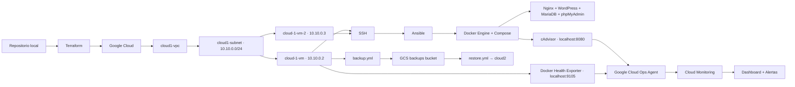
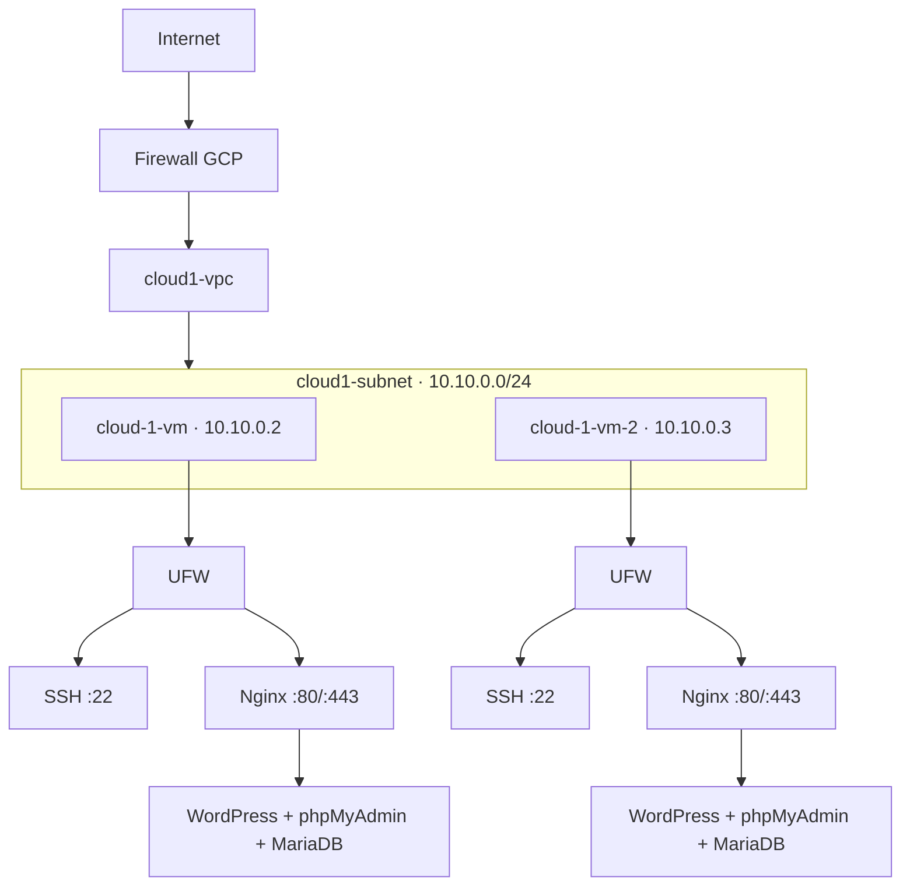
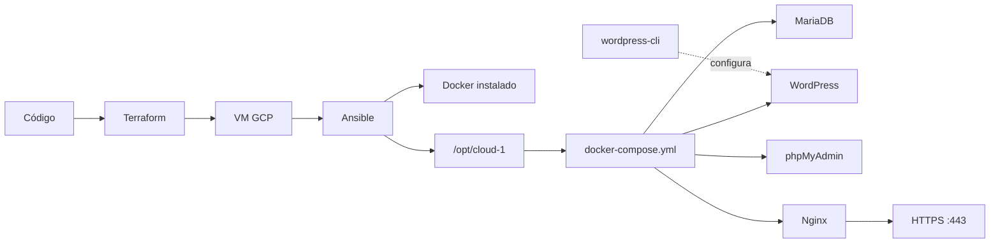
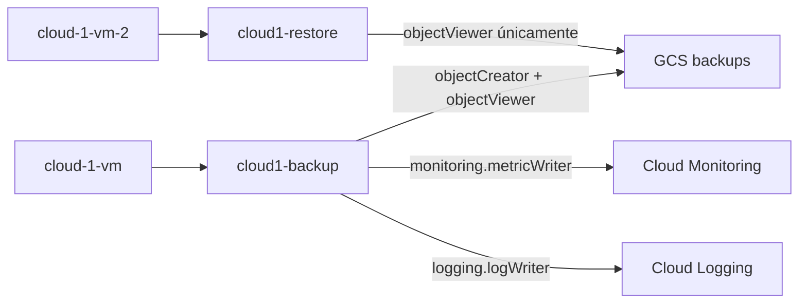
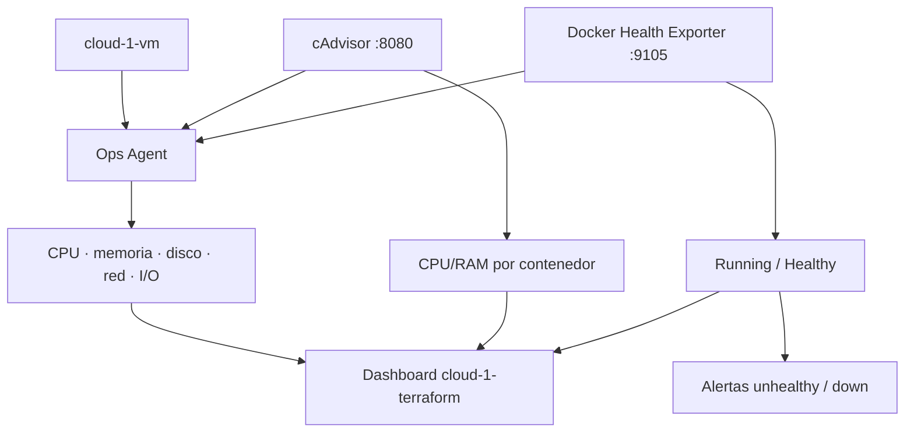
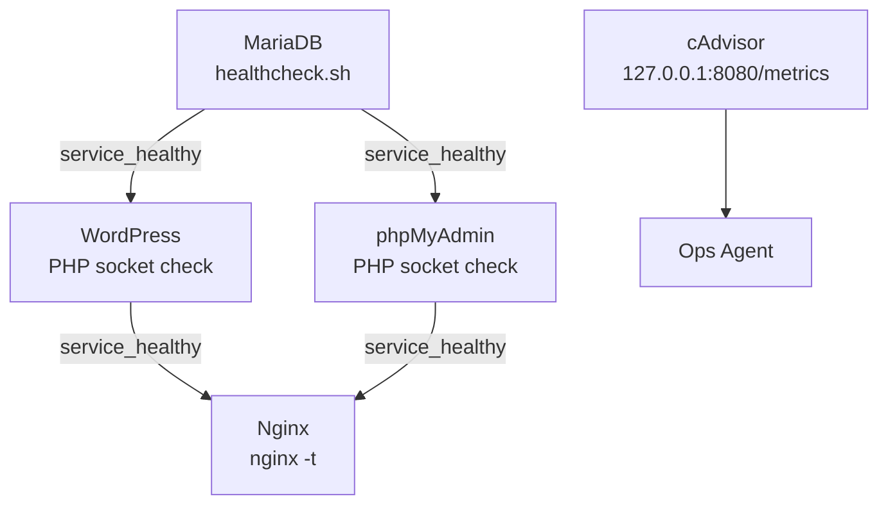
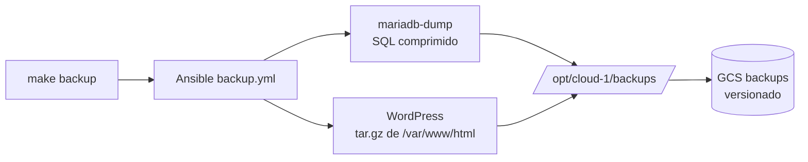
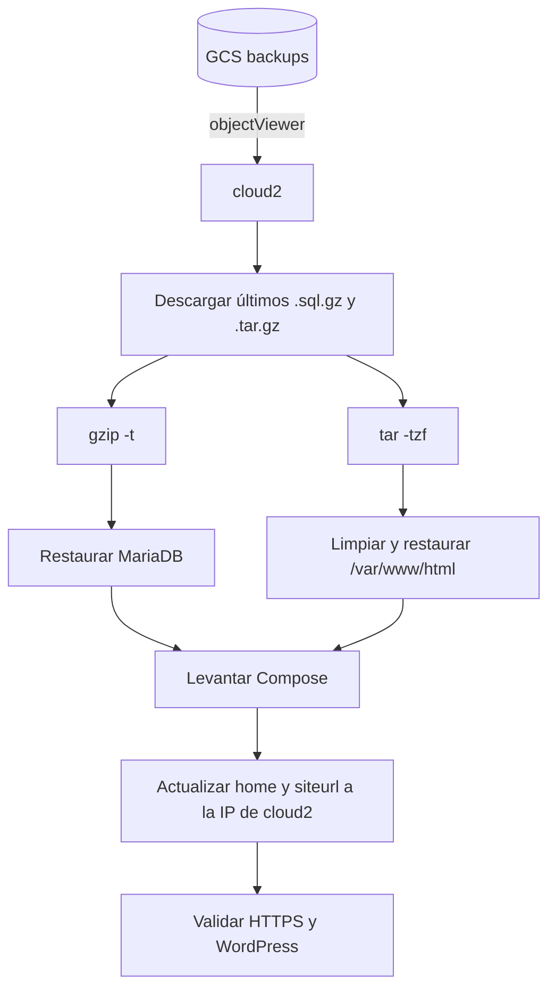
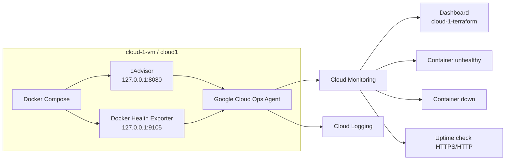
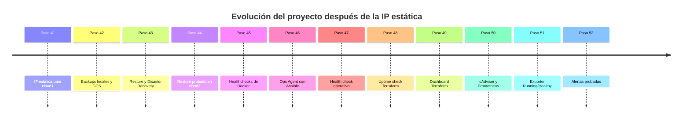

# Cloud-1

Cloud-1 automatiza el camino desde infraestructura en Google Cloud hasta una
aplicación web desplegada en contenedores sobre dos VMs remotas. El proyecto
incluye infraestructura como código, despliegue reproducible, backups en GCS,
restauración probada, healthchecks, métricas, dashboard y alertas gestionados
con Terraform y Ansible.

El proyecto separa responsabilidades en tres capas:

- **Terraform** aprovisiona la infraestructura en Google Cloud.
- **Ansible** configura la VM y prepara el entorno de despliegue.
- **Docker Compose** ejecuta la aplicación y sus componentes de observabilidad:
  Nginx, WordPress, MariaDB, phpMyAdmin y cAdvisor.



## Vista rápida

| Capa | Responsabilidad | Estado |
|---|---|---|
| Terraform | Aprovisionar VM, red y firewall | Implementado/verificado |
| Ansible | Configurar Ubuntu e instalar Docker | Implementado/verificado |
| Deployment | Automatización completa del despliegue | Implementado/verificado en despliegue fresh |
| Docker Compose | Definir los servicios de la aplicación | Implementado/verificado |
| Nginx | Reverse proxy y terminación TLS | Implementado/verificado |
| TLS | Certificado autofirmado y HTTPS | Implementado/verificado |
| WordPress | Aplicación web | Implementado/verificado |
| MariaDB | Base de datos persistente | Implementado/verificado |
| phpMyAdmin | Administración web de MariaDB | Implementado/verificado |
| Secretos | `.env` ignorado, copiado y protegido | Implementado/verificado |
| Persistencia | Volúmenes y recuperación tras reinicios | Implementado/verificado |
| Security | Role de hardening y permisos | Implementado/verificado |
| UFW | Firewall local restrictivo | Implementado/verificado |
| Firewall GCP | Prioridades y deny general | Implementado/verificado |
| Custom VPC | `cloud1-vpc` + `cloud1-subnet` (`10.10.0.0/24`) | Implementado/verificado |
| IP estática | Dirección regional reservada para `cloud-1-vm` | Implementado/verificado |
| Idempotencia | Playbook repetido sin cambios | Implementado/verificado |
| GCS remote state | Backend remoto compartido de Terraform | Implementado/verificado |
| Inventory automático | Consulta directa de IPs en GCP | Implementado/verificado |
| Entorno portable | Docker con Terraform, Ansible y gcloud | Implementado/verificado |
| Backups / DR | MariaDB + WordPress en GCS y restore en `cloud2` | Implementado/verificado |
| Healthchecks | Docker Compose + role `health` | Implementado/verificado |
| Monitorización | Ops Agent + cAdvisor + exporter Prometheus | Implementado/verificado |
| Alerting | Container unhealthy / Container down | Implementado/verificado |

Terraform aplica **Infrastructure as Code**: la infraestructura se expresa en
archivos versionables, revisables y repetibles. Ansible aplica **Configuration
Management**: declara cómo debe quedar el servidor. Docker Compose describe la
aplicación. Esta separación evita mezclar cloud, sistema operativo y servicios.

---

## Arquitectura actual



Cada VM expone únicamente los puertos previstos por el proyecto:

- `22/tcp` para SSH.
- `80/tcp` para HTTP, redirigido a HTTPS.
- `443/tcp` para HTTPS.

MariaDB escucha en `3306` **solo dentro de la red Docker**. WordPress y
phpMyAdmin tampoco publican puertos directamente en el host: Nginx es el único
punto de entrada web.

Actualmente TLS usa un certificado autofirmado generado automáticamente por
Ansible. Es suficiente para validar cifrado y configuración HTTPS, aunque un
navegador mostrará una advertencia de confianza al no existir todavía un
certificado firmado por una CA pública.

---

## Flujo de despliegue



El flujo actual es reproducible desde el playbook: Ansible prepara los archivos,
ejecuta `docker compose up -d`, reinicia Nginx si Compose recrea servicios y usa
`wordpress-cli` para comprobar e instalar WordPress cuando todavía no existe.

---

## Estructura actual del repositorio

```text
cloud-1/
├── Makefile
├── .gitignore
├── .gitattributes
├── README.md
├── cloud-1.pdf
├── scripts/
│   └── generate_inventory.sh
├── tools/
│   └── Dockerfile
├── terraform/
│   ├── providers.tf
│   ├── variables.tf
│   ├── main.tf
│   ├── monitoring.tf
│   ├── outputs.tf
│   └── .terraform.lock.hcl
├── ansible/
│   ├── inventory/
│   │   └── hosts.ini              # generado; no versionar
│   ├── playbook.yml
│   ├── backup.yml
│   ├── restore.yml
│   ├── monitoring.yml
│   ├── health.yml
│   └── roles/
│       ├── docker/
│       │   └── tasks/
│       │       └── main.yml
│       ├── deployment/
│       │   └── tasks/main.yml
│       ├── security/
│       │   └── tasks/main.yml
│       ├── backup/
│       │   └── tasks/main.yml
│       ├── restore/
│       │   └── tasks/main.yml
│       ├── health/
│       │   └── tasks/main.yml
│       └── monitoring/
│           ├── tasks/main.yml
│           ├── handlers/main.yml
│           └── files/docker_health_exporter.py
└── docker/
    ├── docker-compose.yml
    └── nginx/
        └── default.conf
```

## Makefile

El `Makefile` proporciona accesos rápidos para operaciones frecuentes:

| Grupo | Targets principales |
|---|---|
| Terraform | `tf-init`, `tf-validate`, `tf-plan`, `tf-apply` |
| VMs | `vm-start`, `vm-stop`, `vm-start-2`, `vm-stop-2`, `vm-start-all`, `vm-stop-all`, `status` |
| Conectividad | `inventory`, `ping`, `check-cloud1`, `check-cloud2` |
| Despliegue | `deploy`, `deploy-cloud1`, `deploy-cloud2` |
| DR | `backup`, `restore` |
| Observabilidad | `monitoring-cloud1`, `health`, `health-cloud1` |
| Operación | `ps`, `ps-cloud1`, `ps-cloud2`, `logs`, `logs-cloud1`, `logs-cloud2`, `https-cloud1` |
| Portable | `tools-build`, `tools` |

No es un requisito del subject; se incluye como herramienta de comodidad para
desarrollo y evaluación.

El target `make tools` abre el contenedor `cloud1-tools` con el repositorio
montado en `/workspace`, las credenciales locales de gcloud disponibles y la
carpeta SSH montada en modo solo lectura. Así, Terraform, Ansible, gcloud, los
scripts y el propio Makefile se pueden utilizar desde un entorno portable.

Dentro del contenedor se pueden ejecutar, por ejemplo:

```bash
terraform -chdir=terraform plan
./scripts/generate_inventory.sh
make ping
make deploy
make backup
make health-cloud1
```

Un flujo habitual de operación es:


Los certificados TLS **no se guardan en el repositorio**. Ansible los genera
directamente en la VM en:

```text
/opt/cloud-1/certs/
├── cert.pem
└── key.pem
```

---

# Terraform

## `terraform/providers.tf`

Declara el provider `hashicorp/google` con versión `~> 7.0`. El provider usa
las variables `project_id`, `region` y `zone`; separarlo de los recursos
mantiene la configuración de Google Cloud aislada de la infraestructura.

## `terraform/variables.tf`

Centraliza valores reutilizables:

| Variable | Valor por defecto | Uso |
|---|---|---|
| `project_id` | `cloud-1-506415` | Proyecto de Google Cloud |
| `region` | `us-central1` | Región |
| `zone` | `us-central1-c` | Zona |
| `machine_type` | `e2-small` | Tamaño de la VM |

Cada bloque define `description`, `type` y `default`. Usar
`var.machine_type`, por ejemplo, evita repetir valores y facilita cambios.

## `terraform/main.tf`

Define una VPC, una subred regional, dos instancias
(`google_compute_instance.cloud1_vm` y
`google_compute_instance.cloud1_vm_2`), cuatro recursos de firewall, un bucket
de backups y las identidades de backup/restore.

`google_compute_instance.cloud1_vm` es la dirección lógica de Terraform;
`cloud-1-vm` es el nombre real dentro de Google Cloud.

La segunda instancia, `cloud-1-vm-2`, utiliza la misma imagen, zona, tipo de
máquina y tag `cloud1`. Por ese tag reutiliza automáticamente las reglas de
firewall existentes y permite validar despliegues fresh y multi-servidor.

Las dos VMs utilizan:

- Ubuntu 22.04 LTS.
- Disco de 10 GB `pd-balanced`.
- VPC propia `cloud1-vpc`.
- Subred regional `cloud1-subnet`.
- Rango privado `10.10.0.0/24`.
- `cloud-1-vm`: IP pública estática.
- `cloud-1-vm-2`: IP pública efímera.
- Tag `cloud1`.

La topología de red se define explícitamente con Terraform:

```text
cloud1-vpc
└── cloud1-subnet 10.10.0.0/24
    ├── cloud-1-vm
    └── cloud-1-vm-2
```

Las direcciones privadas verificadas actualmente son:

```text
cloud-1-vm    → 10.10.0.2
cloud-1-vm-2  → 10.10.0.3
```

La VPC utiliza `auto_create_subnetworks = false`, por lo que la subred no se
crea automáticamente. Las interfaces de ambas VMs apuntan a
`cloud1-subnet`. Además, `allow_stopping_for_update = true` permite que
Terraform detenga temporalmente una VM para aplicar cambios de red in-place y
la vuelva a iniciar.

Las reglas de firewall permiten:

- SSH: `22/tcp`.
- HTTP: `80/tcp`.
- HTTPS: `443/tcp`.

Las tres reglas `cloud1-allow-*` tienen prioridad `900`. La regla
`cloud1-deny-other-ingress` tiene prioridad `1000`, deniega todo el resto del
tráfico entrante y se aplica a las VMs con tag `cloud1`. Como en GCP un número
menor significa mayor prioridad, SSH, HTTP y HTTPS se evalúan antes del deny.
Las cuatro reglas están asociadas explícitamente a `cloud1-vpc`, por lo que la
seguridad de Cloud-1 ya no depende de reglas heredadas de la VPC `default`,
como `default-allow-rdp` para `3389`.

La base de datos no necesita una regla pública porque permanece en la red
interna de Docker.

### Identidades y bucket de backups

Terraform crea el bucket regional:

```text
gs://cloud-1-506415-backups/
```

con versionado y acceso uniforme. Las identidades siguen el principio de
mínimo privilegio:



`cloud1-backup` puede crear y leer objetos, pero no borrarlos. `cloud1-restore`
solo puede leerlos. Ambas VMs reciben su service account directamente en
Terraform con scope `cloud-platform`; los permisos efectivos los limitan los
roles IAM anteriores.

## `terraform/outputs.tf`

El output `public_ip` devuelve la IP pública conocida por Terraform:

```hcl
google_compute_instance.cloud1_vm.network_interface[0].access_config[0].nat_ip
```

La expresión recorre el recurso, la primera interfaz de red, la primera
configuración de acceso y finalmente `nat_ip`.

El output `public_ip_2` hace lo mismo para `cloud1_vm_2`. Los outputs sirven
para inspección y diagnóstico. El inventory operativo no depende de ellos:
`scripts/generate_inventory.sh` consulta directamente la IP actual de cada VM
con `gcloud compute instances describe`.

`cloud1_vm` utiliza la dirección regional estática `cloud1-static-ip`, por lo
que su IP pública permanece estable. La IP pública de `cloud1_vm_2` sigue
siendo efímera y puede cambiar al detener y volver a arrancar esa VM; el
inventory se regenera automáticamente para recoger cualquier cambio.

## `terraform/monitoring.tf`

Centraliza los recursos de observabilidad gestionados por Terraform:

- Uptime check `cloud-1-web-uptime` contra la IP estática de `cloud-1-vm`.
- Dashboard `cloud-1-terraform`.
- Política `Cloud-1 - Container unhealthy` para
  `cloud1_container_healthy == 0` durante `60s`.
- Política `Cloud-1 - Container down` para
  `cloud1_container_running == 0` durante `60s`.

El dashboard combina métricas del Ops Agent y consultas Prometheus:



Los filtros de memoria y disco se limitan respectivamente a
`metric.labels.state="used"` y a `/dev/sda1` para evitar series irrelevantes.

## `.terraform` y `.terraform.lock.hcl`

`terraform init` descarga providers en `.terraform/`; es contenido generado y
se ignora. El state se almacena actualmente en el backend remoto GCS definido
en `terraform/providers.tf`, usando el bucket del proyecto y el prefijo
`terraform/state`.

`.terraform.lock.hcl` fija versiones y hashes verificados del provider y sí se
versiona.

El state local (`terraform.tfstate`) no debe subirse a Git: puede contener
atributos de infraestructura y datos sensibles. En el clon usado para el
proyecto fue necesario reconstruir el state importando la VM y las reglas que
ya existían antes de aplicar el cambio del firewall; posteriormente se migró
al backend remoto GCS.

Al ejecutar `terraform init` desde Linux y Windows pueden aparecer hashes
adicionales válidos para distintas plataformas aunque la versión del provider
sea la misma.

---

# Ansible

## `ansible/inventory/hosts.ini`

Define:

- El grupo lógico `cloud`.
- Los aliases `cloud1` y `cloud2` para validar despliegue multi-servidor.
- La IP pública actual.
- El usuario SSH.
- La clave privada usada para la conexión.

Las IPs públicas se consultan directamente en GCP. El script
`scripts/generate_inventory.sh` ejecuta `gcloud compute instances describe`
para `cloud-1-vm` y `cloud-1-vm-2`, y genera las entradas de `hosts.ini` solo
cuando la VM tiene una IP disponible. No depende de `terraform output -raw`.
El usuario SSH se puede parametrizar con `CLOUD1_SSH_USER` y la clave con
`CLOUD1_SSH_KEY`.

La IP de `cloud2` puede cambiar al reiniciar la VM, por lo que el inventory se
regenera antes de cada operación. Si una VM está apagada o no tiene IP, el
script omite su línea para evitar entradas inválidas como
`cloud2 ansible_host=`. La IP de `cloud1` permanece estable gracias a
`cloud1-static-ip`.

Además, el usuario SSH puede variar según el equipo desde el que se trabaje.
Por ejemplo, `gcloud compute ssh` puede registrar automáticamente una clave
para el usuario Linux local de una máquina distinta. Por eso conviene validar
primero SSH y después Ansible.

## `ansible/playbook.yml`

El playbook actual:

- Usa `hosts: cloud`.
- Usa `become: true`.
- Ejecuta el role `docker`.
- Ejecuta el role `deployment`.
- Ejecuta el role `security`.

`become: true` eleva privilegios para instalar paquetes, modificar `/etc`,
gestionar servicios y escribir en `/opt`.

## Role `docker`

`ansible/roles/docker/tasks/main.yml` instala Docker de forma declarativa:

| Tarea | Módulo | Objetivo |
|---|---|---|
| Actualizar caché | `apt` | Mantener índices APT actualizados |
| Instalar dependencias | `apt` | Garantizar paquetes necesarios |
| Crear keyring | `file` | Preparar `/etc/apt/keyrings` |
| Descargar clave GPG | `get_url` | Verificar origen del repositorio |
| Añadir repo Docker | `apt_repository` | Configurar repositorio oficial |
| Instalar Docker | `apt` | Instalar Engine, CLI y plugins |
| Iniciar Docker | `service` | Garantizar `started` + `enabled` |

Se instalan:

- `docker-ce`
- `docker-ce-cli`
- `containerd.io`
- `docker-buildx-plugin`
- `docker-compose-plugin`

Verificación registrada durante el desarrollo:

```text
Docker version 29.7.2
Docker Compose version v5.5.0
```

## Role `deployment`

El role `deployment` está implementado. Actualmente:

1. Crea `/opt/cloud-1`.
2. Crea `/opt/cloud-1/data`. Este directorio forma parte de la estructura
   preparada por el role, pero no contiene actualmente los datos persistentes
   de WordPress y MariaDB.
3. Copia `docker-compose.yml`.
4. Copia `nginx/default.conf`.
5. Crea `/opt/cloud-1/certs`.
6. Genera un certificado TLS autofirmado si todavía no existe.
7. Ejecuta `docker compose up -d` desde `/opt/cloud-1`.
8. Reinicia Nginx si Compose creó, recreó o inició servicios.
9. Comprueba con `wp core is-installed` si WordPress ya está instalado.
10. Ejecuta `wp core install` usando las variables del archivo `.env` cuando
    todavía no existe una instalación.
11. Actualiza `home` y `siteurl` con la IP pública actual.

La generación del certificado usa la propiedad `creates`, por lo que no vuelve
a ejecutarse si `cert.pem` ya existe.

Conceptualmente:

```text
Repositorio
   ↓ Ansible
/opt/cloud-1/
├── docker-compose.yml
├── default.conf
├── data/
└── certs/
    ├── cert.pem
    └── key.pem
```

La persistencia actual utiliza los named volumes de Docker `wordpress_data` y
`mariadb_data`, no `/opt/cloud-1/data`.

Además, autoriza de forma declarativa la clave pública de la máquina de control
en `/root/.ssh/authorized_keys`, permitiendo acceso SSH directo como `root`
mediante clave pública. La configuración efectiva de SSH se verificó con
`PermitRootLogin without-password`, `PubkeyAuthentication yes` y
`PasswordAuthentication no`.

## Role `security`

El role `security` está implementado. Instala y activa UFW con política
`deny` para conexiones entrantes y `allow` para conexiones salientes. Solo
permite `22/tcp`, `80/tcp` y `443/tcp`. También asegura los permisos de los
archivos sensibles: `.env` y `key.pem` con `0600`, y `cert.pem` con `0644`.

## Flujos Ansible independientes

Las operaciones de producción y las operaciones auxiliares están separadas en
playbooks pequeños, con un único objetivo por flujo:

| Playbook | Host objetivo | Role | Función |
|---|---|---|---|
| `playbook.yml` | `cloud` | `docker`, `deployment`, `security` | Despliegue principal |
| `backup.yml` | `cloud1` | `backup` | Crear y subir backups |
| `restore.yml` | `cloud2` | `restore` | Recuperar desde GCS |
| `monitoring.yml` | `cloud1` | `monitoring` | Ops Agent y exporters |
| `health.yml` | `cloud1` | `health` | Validación técnica |

Esta separación evita que un despliegue normal ejecute accidentalmente un
restore o un backup. Los roles relacionados quedan organizados así:

```text
ansible/
├── backup.yml
├── restore.yml
├── monitoring.yml
├── health.yml
└── roles/
    ├── backup/tasks/main.yml
    ├── restore/tasks/main.yml
    ├── health/tasks/main.yml
    └── monitoring/
        ├── files/docker_health_exporter.py
        ├── handlers/main.yml
        └── tasks/main.yml
```

---

# Portabilidad

## Terraform State remoto en GCS

Terraform utiliza un backend remoto en Google Cloud Storage configurado en
`terraform/providers.tf`:

```text
bucket: cloud-1-506415-tfstate
prefix: terraform/state
```

El state local se migró al backend remoto y se validó con `terraform state list`,
`gcloud storage ls` y `terraform plan`, que devolvió `No changes`.

## Inventory automático

`scripts/generate_inventory.sh` consulta directamente la API de Compute Engine
con `gcloud compute instances describe` y genera
`ansible/inventory/hosts.ini` con `cloud1` y `cloud2` cuando tienen IP pública.
Así el flujo funciona también con la IP efímera de `cloud2`, sin depender de
outputs de Terraform ni de copiar direcciones manualmente.

El archivo es generado y no debe formar parte de los commits; se regenera con
`make inventory` antes de las operaciones Ansible.

El script admite las variables `CLOUD1_SSH_USER` y `CLOUD1_SSH_KEY` para evitar
fijar el usuario y la clave SSH al equipo desde el que se trabaja.

El target `inventory` del `Makefile` ejecuta el script automáticamente antes de
`make ping`, `make deploy`, `make compose-config`, `make up`, `make down`,
`make ps` y `make logs`.

## Contenedor portable de administración

`tools/Dockerfile` construye la imagen `cloud1-tools` con Terraform, Ansible,
Google Cloud CLI, Git, Python, OpenSSH client y Make. El repositorio se monta
en `/workspace`; la configuración de gcloud se reutiliza y la carpeta SSH se
monta en modo solo lectura. Las credenciales no se copian dentro de la imagen.

Versiones verificadas dentro del contenedor:

```text
Terraform v1.16.2
Ansible core 2.17.14
Google Cloud SDK 584.0.0
```

El target `make tools` abre este entorno portable con un solo comando. Dentro
se pueden ejecutar Terraform, generar el inventory y lanzar Ansible:

```bash
make tools
terraform -chdir=terraform plan
./scripts/generate_inventory.sh
make ping
make deploy
```

---

# Docker Compose

## Servicios

El `docker-compose.yml` actual define seis servicios: MariaDB, WordPress,
phpMyAdmin, Nginx, cAdvisor y `wordpress-cli`. Este último usa un perfil
auxiliar y no queda ejecutándose como servicio público permanente.

### MariaDB

Responsabilidad:

- Base de datos de WordPress.
- Persistencia mediante volumen Docker.
- Acceso únicamente desde la red interna.

La base de datos no publica `3306` hacia Internet.

### WordPress

Responsabilidad:

- Aplicación web principal.
- Conexión a `mariadb:3306`.
- Persistencia de `/var/www/html`.

WordPress no publica su puerto `80` directamente en la VM.

### phpMyAdmin

Responsabilidad:

- Interfaz web para administrar MariaDB.
- Se conecta a MariaDB usando su nombre de servicio Docker.

phpMyAdmin tampoco publica directamente su puerto `80`.

### cAdvisor

cAdvisor recoge métricas Prometheus del runtime de Docker, incluyendo CPU,
memoria, red e I/O por contenedor. Se ejecuta como `cloud1_cadvisor` dentro de
la red `cloud1_network` y monta en solo lectura los recursos del host
necesarios para observar Docker.

Su endpoint está publicado únicamente en localhost:

```text
127.0.0.1:8080 → cAdvisor /metrics
```

Por tanto, cAdvisor no queda expuesto directamente a Internet. El Google Cloud
Ops Agent consulta ese endpoint desde la propia VM y envía las métricas a Cloud
Monitoring.

### Nginx

Responsabilidad:

- Único punto de entrada web.
- Reverse proxy hacia WordPress y phpMyAdmin.
- Publicación de `80` y `443`.
- Redirección HTTP → HTTPS.
- Terminación TLS.

Routing actual:

```text
https://IP_VM/             → WordPress
https://IP_VM/phpmyadmin/  → phpMyAdmin
```

### wordpress-cli

`wordpress-cli` usa la imagen `wordpress:cli`, comparte el volumen de
WordPress y pertenece al perfil `cli`. Ansible lo ejecuta bajo demanda para
comprobar la instalación, instalar WordPress y actualizar sus URLs. No publica
puertos ni forma parte de la entrada web permanente.

Durante la validación fresh se detectó que `wordpress:cli` utiliza `www-data`
con UID `82`, mientras que el contenedor principal de WordPress utiliza UID
`33`. Para compartir el volumen con permisos coherentes, `wordpress-cli` se
ejecuta con `user: "33:33"`.

### Dependencias y healthchecks

Los servicios principales incorporan healthchecks internos. WordPress y
phpMyAdmin esperan a que MariaDB esté `healthy`, y Nginx espera a que los
servicios web estén preparados:



La disponibilidad HTTP/HTTPS se valida además desde fuera de la VM, porque
el healthcheck de Nginx valida la configuración local y no sustituye una
comprobación del endpoint público.

---

# Persistencia

Compose define actualmente:

```text
mariadb_data
wordpress_data
```

`mariadb_data` conserva la información de la base de datos y
`wordpress_data` conserva los archivos de WordPress aunque los contenedores
sean recreados.

Los servicios persistentes `mariadb`, `wordpress`, `phpmyadmin` y `nginx` usan:

```yaml
restart: unless-stopped
```

para volver a arrancar cuando Docker o la VM regresan, salvo que hayan sido
detenidos explícitamente. `wordpress-cli` se ejecuta únicamente bajo demanda
mediante el profile `cli` y no es un servicio permanente.

La persistencia se comprobó tras reiniciar la VM y tras ejecutar
`docker compose down` seguido de `docker compose up`, sin eliminar volúmenes.
`docker compose down -v` sí eliminaría los volúmenes y no se utilizó en esta
prueba.

---

# TLS / HTTPS

El certificado autofirmado se genera automáticamente desde Ansible y no se
versiona.

La clave privada queda con permisos restrictivos en la VM.

Nginx monta:

```text
/opt/cloud-1/certs
        ↓
/etc/nginx/certs
```

y escucha en:

```text
80/tcp  → redirect 301 → HTTPS
443/tcp → TLS + reverse proxy
```

Validación realizada:

```bash
curl -I http://IP_VM
curl -k -I https://IP_VM
curl -k -I https://IP_VM/phpmyadmin/
```

Resultados observados:

```text
HTTP                → 301 hacia HTTPS
HTTPS /             → WordPress operativo
HTTPS /phpmyadmin/  → phpMyAdmin operativo
```

`curl -k` se usa únicamente porque el certificado actual es autofirmado.

---

# Backups y Disaster Recovery

Cloud-1 cuenta con un flujo de backup y recuperación independiente del
despliegue principal. Los backups se ejecutan sobre `cloud1` mediante el role
`backup` y se almacenan en un bucket GCS separado:

```text
gs://cloud-1-506415-backups/
```

El bucket tiene versionado y acceso uniforme por IAM. En cada ejecución se
generan dos archivos locales en `/opt/cloud-1/backups` con permisos `0700`:

```text
mariadb-YYYYMMDD-HHMMSS.sql.gz
wordpress-YYYYMMDD-HHMMSS.tar.gz
```

El backup de MariaDB contiene todas las bases de datos (`--all-databases`). El
backup de WordPress contiene todo `/var/www/html`. El playbook conserva los
nombres exactos generados durante esa ejecución y sube únicamente esos dos
archivos, evitando volver a transferir backups antiguos.



## Identidades y mínimo privilegio

Terraform crea dos identidades separadas:

| VM | Service Account | Permisos relevantes |
|---|---|---|
| `cloud-1-vm` (`cloud1`) | `cloud1-backup` | Crear/leer objetos del bucket, escribir métricas y logs |
| `cloud-1-vm-2` (`cloud2`) | `cloud1-restore` | Solo leer objetos del bucket |

La identidad de restore no puede crear ni borrar objetos. No se utilizan
credenciales personales dentro de las VMs: las operaciones GCS usan la
identidad adjunta a cada instancia.

## Restore y recuperación ante desastre

`ansible/restore.yml` está limitado a `cloud2`. El flujo descarga desde GCS el
backup más reciente de MariaDB y WordPress, valida ambos archivos y restaura
los datos sobre la segunda VM:



La recuperación se probó de extremo a extremo en `cloud2`: los archivos fueron
válidos, WordPress recuperó la conexión con MariaDB y el endpoint HTTPS
respondió correctamente. El flujo no elimina objetos del bucket ni modifica
la VM principal.

Comandos habituales:

```bash
make backup
make restore
make ps-cloud2
make logs-cloud2
```

`make restore` requiere que `cloud2` tenga IP pública disponible, porque el
inventory se genera dinámicamente antes de ejecutar Ansible.

# Observabilidad y alerting

La observabilidad combina métricas del host, métricas de contenedores,
healthchecks locales, dashboard gestionado por Terraform y alertas de Cloud
Monitoring.



## Google Cloud Ops Agent

El role `monitoring` instala y configura Google Cloud Ops Agent mediante
Ansible. Su configuración recoge dos endpoints Prometheus locales:

| Receiver | Endpoint | Datos |
|---|---|---|
| `cadvisor` | `127.0.0.1:8080` | CPU, memoria, red e I/O por contenedor |
| `docker_health` | `127.0.0.1:9105` | Estado `running` y `healthy` de cada contenedor |

La service account `cloud1-backup` tiene además los roles mínimos necesarios
para que Ops Agent publique datos:

```text
roles/monitoring.metricWriter
roles/logging.logWriter
```

El agente envía métricas y logs a los servicios gestionados de Google Cloud.
No se abre ningún puerto nuevo en el firewall: los exporters escuchan solo en
`127.0.0.1`.

Despliegue y comprobación:

```bash
make monitoring-cloud1

ansible cloud1 -i ansible/inventory/hosts.ini -b -m shell \
  -a 'systemctl status google-cloud-ops-agent --no-pager'
```

## cAdvisor y Docker Health Exporter

cAdvisor publica métricas Prometheus de los contenedores. El exporter propio,
instalado como `docker-health-exporter.service`, consulta `docker inspect` y
expone:

```text
cloud1_container_running{name="cloud1_nginx"} 1
cloud1_container_healthy{name="cloud1_nginx"} 1
```

Las métricas se generan para MariaDB, WordPress, Nginx, phpMyAdmin y cAdvisor.
El valor `1` significa activo/sano y `0` significa detenido/no sano. El
servicio se reinicia automáticamente mediante systemd si falla.

Comprobaciones directas desde Ansible:

```bash
ansible cloud1 -i ansible/inventory/hosts.ini -b -m shell \
  -a 'curl -s http://127.0.0.1:8080/metrics | head -30'

ansible cloud1 -i ansible/inventory/hosts.ini -b -m shell \
  -a 'curl -s http://127.0.0.1:9105/metrics'
```

## Dashboard Terraform

`terraform/monitoring.tf` mantiene el dashboard `cloud-1-terraform`. Sus
widgets cubren:

- CPU de `cloud-1-vm`.
- Memoria usada, filtrada por `state="used"`.
- Disco usado de `/dev/sda1`, filtrado por `state="used"`.
- Tráfico de red y lectura/escritura de disco.
- Tabla de contenedores activos (`cloud1_container_running`).
- Tabla de contenedores sanos (`cloud1_container_healthy`).
- CPU por contenedor mediante PromQL.
- Memoria por contenedor mediante PromQL.

Los filtros del host utilizan el `instance_id` dinámico de Terraform, no un
identificador pegado manualmente. Las consultas de contenedores agrupan por el
label `name`, de modo que el dashboard muestra cada servicio por separado.

## Uptime check y alertas

Terraform también mantiene un uptime check global para `cloud-1-vm`, usando la
IP estática reservada y validando la respuesta 2XX de `/` cada 60 segundos.

Las dos políticas PQL están habilitadas y se probaron realmente:

| Política | Consulta | Duración |
|---|---|---|
| `Cloud-1 - Container unhealthy` | `cloud1_container_healthy == 0` | 60 s |
| `Cloud-1 - Container down` | `cloud1_container_running == 0` | 60 s |

La primera se validó con una prueba controlada sobre cAdvisor, sin detener
MariaDB ni WordPress. Después se revirtió el exporter y se comprobó que la
métrica volvió a `1`. La segunda quedó creada en Terraform para detectar un
contenedor que deje de estar ejecutándose.

---

# Bitácora técnica

## Paso 1 — Diseñar la automatización

**Objetivo.** Reemplazar creación y configuración manual por un proceso
repetible.

**Qué hicimos.** Se separaron Terraform, Ansible y Docker Compose.

```text
Terraform → infraestructura
Ansible   → configuración de la VM
Compose   → aplicación
```

**Concepto aprendido.** Estado deseado: declarar qué debe existir en lugar de
depender de una secuencia manual de clics.

---

## Paso 2 — Autenticar Google Cloud e inicializar Terraform

**Objetivo.** Permitir al provider de Google comunicarse con las APIs.

```bash
gcloud auth login
gcloud config set project cloud-1-506415
gcloud auth application-default login
gcloud auth application-default set-quota-project cloud-1-506415

terraform init
terraform validate
```

**Aprendizaje.**

`gcloud auth login` autentica la CLI.

Application Default Credentials, o ADC, son las credenciales que Terraform
puede descubrir sin almacenarlas en Git.

`terraform validate` valida configuración, pero no crea infraestructura.

---

## Paso 3 — Planificar y aplicar infraestructura

```bash
terraform plan
terraform apply
```

Resultado registrado:

```text
Plan: 4 to add, 0 to change, 0 to destroy
```

**Aprendizaje.**

`plan` compara estado deseado y estado conocido.

`apply` crea o modifica recursos reales.

Terraform State relaciona código y recursos remotos. Puede contener datos
sensibles y no debe subirse al repositorio.

---

## Paso 4 — Resolver SSH entre Windows, WSL y GCP

**Problema.**

Ansible alcanzaba la VM, pero SSH respondía:

```text
Permission denied (publickey)
```

La clave creada por `gcloud` estaba en Windows mientras Ansible se ejecutaba
desde WSL.

**Solución.**

Reutilizar la clave desde WSL y protegerla:

```bash
chmod 600 ~/.ssh/google_compute_engine
```

**Aprendizaje.**

Un fallo `publickey` no significa necesariamente fallo de red: llegar hasta ese
mensaje ya demuestra que el host y el puerto SSH responden.

---

## Paso 5 — Verificar Ansible

```bash
ansible all -i inventory/hosts.ini -m ping
```

Resultado:

```text
cloud1 | SUCCESS => {
    "changed": false,
    "ping": "pong"
}
```

No es ICMP. El módulo `ping` comprueba:

```text
Ansible → SSH → Python remoto → módulo → pong
```

---

## Paso 6 — Instalar Docker declarativamente

Flujo:

```text
APT
 ↓
dependencias
 ↓
/etc/apt/keyrings
 ↓
clave GPG
 ↓
repositorio oficial Docker
 ↓
Docker Engine + Compose
```

La clave GPG permite verificar origen e integridad de los paquetes.

`{{ ansible_distribution_release }}` es un Ansible Fact recopilado del host.
En Ubuntu 22.04 corresponde a `jammy`.

---

## Paso 7 — Comprobar idempotencia

**Objetivo.** Ejecutar varias veces el mismo playbook sin producir cambios
innecesarios.

Resultado observado en segundas ejecuciones:

```text
changed=0
failed=0
```

Los módulos declarativos conocen el estado deseado.

En cambio, un comando ad-hoc ejecutado con `command` o `shell` puede aparecer
como `CHANGED` aunque solo esté consultando información.

---

## Paso 8 — Continuar desde un PC de 42

**Objetivo.** Confirmar que Cloud-1 no depende del PC personal.

Se verificaron:

```text
Terraform ✅
gcloud ✅
Ansible ✅
SSH ✅
```

En el entorno de 42 Ansible estaba instalado con:

```bash
python3 -m pip install --user ansible
```

En una shell donde `~/.local/bin` no estaba en `PATH` fue necesario:

```bash
export PATH="$HOME/.local/bin:$PATH"
```

`gcloud compute ssh` generó una clave SSH para ese entorno y permitió comprobar
qué usuario Linux remoto estaba autorizado.

**Aprendizaje.**

El inventory no debe asumir que el mismo usuario SSH funciona desde todos los
equipos.

---

## Paso 9 — Preparar `/opt/cloud-1`

El role `deployment` creó:

```text
/opt/cloud-1
/opt/cloud-1/data
```

Primera ejecución:

```text
changed=1
```

Segunda ejecución:

```text
changed=0
```

Esto confirmó idempotencia.

---

## Paso 10 — Copiar Docker Compose con Ansible

Se añadió una tarea `copy` para llevar:

```text
docker/docker-compose.yml
```

a:

```text
/opt/cloud-1/docker-compose.yml
```

Primera ejecución: `changed`.

Segunda ejecución: `ok`.

El archivo se validó remotamente con:

```bash
ansible cloud -i inventory/hosts.ini -b -m shell \
  -a "cd /opt/cloud-1 && docker compose config"
```

**Aprendizaje.**

El módulo `command` no interpreta operadores de shell como `cd` o `&&`.
Cuando se necesitan, debe usarse `shell`, o preferiblemente un módulo
declarativo específico cuando exista.

---

## Paso 11 — Levantar MariaDB

Se levantó primero la base de datos para aislar problemas:

```bash
docker compose up -d mariadb
```

Se verificó con:

```bash
docker ps
docker logs --tail 30 cloud1_mariadb
```

Resultado clave:

```text
mariadbd: ready for connections
```

**Aprendizaje.**

MariaDB puede escuchar en `3306` dentro del contenedor sin publicar ese puerto
hacia Internet.

---

## Paso 12 — Añadir WordPress

WordPress se conectó a:

```text
mariadb:3306
```

usando DNS interno de Docker Compose.

Se añadió volumen persistente:

```text
wordpress_data:/var/www/html
```

Los logs confirmaron que WordPress se copió correctamente y Apache quedó
ejecutándose en foreground.

---

## Paso 13 — Añadir phpMyAdmin

phpMyAdmin se configuró para acceder a:

```text
PMA_HOST=mariadb
PMA_PORT=3306
```

Se verificó que el contenedor permanecía `Up` y que Apache/PHP iniciaron sin
errores bloqueantes.

---

## Paso 14 — Añadir Nginx como reverse proxy

Se creó:

```text
docker/nginx/default.conf
```

y Ansible lo copia a:

```text
/opt/cloud-1/default.conf
```

Nginx se añadió a Compose y se conectó a la misma red interna.

Primera prueba HTTP:

```bash
curl -I http://IP_VM
```

WordPress respondió con un redirect al instalador y phpMyAdmin devolvió
`200 OK`.

Esto confirmó que el routing funcionaba.

---

## Paso 15 — Generar TLS automáticamente

Ansible crea:

```text
/opt/cloud-1/certs
```

y ejecuta OpenSSL solo si el certificado todavía no existe.

La tarea usa `creates` para mantener idempotencia.

Primera ejecución:

```text
Generar certificado TLS autofirmado → changed
```

Segunda ejecución:

```text
Generar certificado TLS autofirmado → ok
```

Archivos generados:

```text
cert.pem
key.pem
```

La clave privada tiene permisos más restrictivos que el certificado público.

---

## Paso 16 — Activar HTTPS

Nginx quedó configurado con:

```text
80  → redirect 301
443 → TLS
```

Compose publica:

```text
0.0.0.0:80->80/tcp
0.0.0.0:443->443/tcp
```

Validación final:

```text
HTTP                         → 301 hacia HTTPS
HTTPS /                      → WordPress
HTTPS /phpmyadmin/           → 200 OK
MariaDB                      → solo red interna
```

## Paso 17 — Eliminar secretos hard-coded

**Objetivo.** Evitar que las credenciales aparezcan directamente en
`docker-compose.yml`.

**Solución.** Se sustituyeron las credenciales embebidas por variables de
entorno, se creó `docker/.env` y se añadió `docker/.env` al `.gitignore`.
Ansible copia ese archivo a `/opt/cloud-1/.env` con permisos `0600` y usa
`no_log: true` durante la copia y la instalación de WordPress.

**Aprendizaje.** Un archivo local ignorado por Git evita subir secretos al
repositorio, pero debe protegerse también en la VM y no aparecer en los logs.

## Paso 18 — Rotación de credenciales

**Problema.** Las credenciales temporales utilizadas durante el desarrollo se
consideraron comprometidas al haber formado parte de configuraciones de prueba.

**Solución.** Se rotaron las credenciales de MariaDB sin destruir los
volúmenes persistentes. No se documenta ningún valor real de contraseña en el
README.

**Aprendizaje.** Rotar un secreto no obliga a perder los datos, pero en una
instalación real hay que planificar la actualización coordinada de los
servicios que lo consumen.

## Paso 19 — Automatizar Docker Compose desde Ansible

**Objetivo.** Hacer que el despliegue completo termine levantando los servicios
desde el playbook.

**Solución.** `docker compose up -d` pasó a ejecutarse en el role `deployment`.
También se añadió un reinicio condicional de Nginx cuando Compose crea,
recrea o inicia servicios.

**Problema encontrado.** Después de recrear WordPress apareció un `502 Bad
Gateway`: Nginx conservaba una resolución DNS anterior del contenedor.

**Aprendizaje.** Reiniciar Nginx después de que Compose recree servicios fuerza
la resolución actualizada y elimina ese estado obsoleto.

## Paso 20 — Automatización de WordPress

**Objetivo.** Evitar la instalación manual inicial de WordPress.

**Solución.** Se añadió `wordpress-cli` con el perfil `cli`. Ansible ejecuta
`wp core is-installed`; si no existe una instalación, ejecuta `wp core install`
con las variables del `.env`. Después sincroniza `home` y `siteurl` con la IP
pública actual.

**Problema encontrado.** El primer intento falló porque `wordpress-cli` no tenía
las variables de conexión a MariaDB. Se corrigió añadiendo al servicio las
mismas variables `WORDPRESS_DB_*` que utiliza WordPress.

**Aprendizaje.** Un contenedor auxiliar necesita la configuración de la misma
dependencia que la aplicación que administra, aunque no sea un servicio
público permanente.

## Paso 21 — Prueba de reinicio de la VM

**Objetivo.** Comprobar la recuperación automática de la aplicación.

**Resultado.** Se reinició la instancia. Docker volvió a arrancar y los
contenedores con `restart: unless-stopped` volvieron automáticamente.
WordPress y phpMyAdmin siguieron funcionando.

**Aprendizaje.** La política de reinicio protege frente a reinicios del host,
pero no sustituye las comprobaciones de salud ni la monitorización.

## Paso 22 — Prueba de persistencia

**Objetivo.** Confirmar que los datos sobreviven a la recreación de
contenedores.

**Prueba.** Se ejecutó `docker compose down` y posteriormente `docker compose
up`, sin eliminar volúmenes. `wordpress_data` y `mariadb_data` conservaron los
datos.

`docker compose down -v` sí eliminaría los volúmenes; no se utilizó porque
habría destruido la persistencia que se estaba comprobando.

**Aprendizaje.** La persistencia depende de separar los datos de la vida de
los contenedores y de no usar accidentalmente la opción `-v`.

## Paso 23 — Idempotencia del deployment

**Objetivo.** Ejecutar de nuevo el playbook sin repetir cambios innecesarios.

**Resultado.** Antes de añadir `security`, la segunda ejecución terminó con:

```text
ok=19 changed=0 failed=0
```

**Aprendizaje.** La idempotencia demuestra que Ansible reconoce el estado ya
configurado y no vuelve a modificar directorios, archivos, certificados o
servicios sin necesidad.

## Paso 24 — Implementación del role security

**Objetivo.** Añadir un firewall local y asegurar archivos sensibles.

**Solución.** El role instaló y configuró UFW con `deny incoming` y
`allow outgoing`. Solo se permitieron `22/tcp`, `80/tcp` y `443/tcp`. SSH se
verificó después de activar UFW y siguió funcionando.

**Aprendizaje.** Las reglas deben estar configuradas antes de activar una
política restrictiva para evitar bloquear el acceso de administración.

## Paso 25 — Permisos de archivos sensibles

Se verificaron los permisos finales:

```text
/opt/cloud-1/.env          → 0600
/opt/cloud-1/certs/key.pem → 0600
/opt/cloud-1/certs/cert.pem → 0644
```

La clave privada y el archivo de variables quedan limitados al propietario,
mientras que el certificado público puede ser legible.

## Paso 26 — Verificación de exposición de puertos

`docker ps` confirmó que solo Nginx publica `80` y `443`. WordPress y
phpMyAdmin exponen su puerto `80` únicamente dentro de la red Docker y MariaDB
usa `3306` solo internamente.

Además, `ss -tulpn` confirmó que los puertos TCP públicos relevantes del host
son `22`, `80` y `443`.

**Aprendizaje.** La publicación de puertos debe limitarse al único componente
que necesita recibir tráfico externo: Nginx.

## Paso 27 — Endurecimiento del firewall de GCP

**Problema.** Se detectó una regla heredada `default-allow-rdp` para `3389` en
la VPC `default`.

**Solución.** Las reglas `cloud1-allow-ssh`, `cloud1-allow-http` y
`cloud1-allow-https` recibieron prioridad `900`. Se creó
`cloud1-deny-other-ingress` con prioridad `1000` y `deny all` para las VMs con
tag `cloud1`.

En GCP, un número de prioridad menor se evalúa antes. Por eso las tres reglas
permitidas se aplican antes del deny general, que bloquea el resto del tráfico
entrante y evita que el RDP heredado llegue a la VM.

## Paso 28 — Reconstrucción del Terraform state

**Problema.** En el clon del campus no existía `terraform.tfstate`.
`terraform plan` intentó proponer la creación de recursos que ya existían.

**Solución.** No se ejecutó `apply` en ese estado. Se importaron la VM y las
tres reglas de firewall existentes. Después se aplicó únicamente el cambio
esperado del firewall.

Resultado registrado:

```text
1 added, 4 changed, 0 destroyed
```

Después, `terraform plan` devolvió:

```text
No changes. Your infrastructure matches the configuration.
```

**Aprendizaje.** El state enlaza los recursos reales con la configuración y no
debe subirse a Git porque puede contener información sensible y es específico
del entorno.

## Paso 29 — Idempotencia final

Tras completar `security`, el playbook volvió a ejecutarse y terminó con:

```text
ok=29 changed=0 failed=0
```

SSH siguió funcionando mediante `make ping`, que devolvió `pong`.

**Resultado.** La configuración completa —Docker, deployment, WordPress,
TLS, UFW y permisos— quedó verificada como idempotente.

## Paso 30 — Acceso SSH directo como root

**Objetivo.** Validar el acceso directo como `root` exigido por el subject sin
habilitar autenticación por contraseña.

**Solución.** Se añadió al role `security` una tarea
`ansible.posix.authorized_key` que copia la clave pública de la máquina de
control a `/root/.ssh/authorized_keys`.

La configuración efectiva de OpenSSH se verificó como:

```text
PermitRootLogin without-password
PubkeyAuthentication yes
PasswordAuthentication no
```

La conexión directa mediante SSH como `root` se validó correctamente.

## Paso 31 — Añadir una segunda VM para validación multi-servidor

Terraform se amplió con `google_compute_instance.cloud1_vm_2`, una segunda
instancia Ubuntu 22.04 LTS con la misma etiqueta `cloud1`. Las reglas de
firewall existentes se reutilizan automáticamente mediante ese tag.

El plan esperado para añadirla fue:

```text
Plan: 1 to add, 0 to change, 0 to destroy.
```

## Paso 32 — Diagnóstico del despliegue fresh

En la primera ejecución sobre una VM completamente nueva, Ansible llegó hasta
`Instalar WordPress` y falló. La prueba permitió detectar dos problemas reales:

1. Las llamadas a WP-CLI omitían el ejecutable `wp`. Se corrigieron:

   ```text
   core is-installed  → wp core is-installed
   core install       → wp core install
   option update      → wp option update
   ```

2. `wordpress-cli` y WordPress usaban UID distintos para `www-data`:

   ```text
   wordpress       → UID 33
   wordpress-cli   → UID 82
   ```

   Se corrigió el servicio auxiliar con `user: "33:33"` para compartir el
   volumen con permisos coherentes.

## Paso 33 — Validación fresh definitiva

La segunda VM se destruyó y recreó mediante Terraform para garantizar un
entorno realmente vacío. Después se ejecutó el playbook únicamente contra
`cloud2`.

Resultado:

```text
cloud2 : ok=31 changed=17 unreachable=0 failed=0 skipped=1
```

También se verificó HTTPS con `200 OK`, WordPress instalado mediante
`wp core is-installed` con retorno `0`, y los cuatro servicios principales
ejecutándose. WordPress y phpMyAdmin fueron accesibles desde el navegador.

## Paso 34 — Despliegue paralelo multi-servidor

El inventory se probó con `cloud1` y `cloud2` dentro del grupo `cloud`. El
playbook se ejecutó sin `--limit`, por lo que Ansible aplicó las tareas a ambos
hosts.

Resultado final:

```text
cloud1 : ok=30 changed=2 unreachable=0 failed=0 skipped=2
cloud2 : ok=30 changed=0 unreachable=0 failed=0 skipped=2
```

Se verificaron también las páginas de WordPress y phpMyAdmin en ambas VMs.

## Paso 35 — Migrar Terraform State a GCS

**Objetivo.** Compartir el state de Terraform entre equipos y entornos.

**Solución.** Se configuró el backend `gcs` en `terraform/providers.tf` con el
bucket `cloud-1-506415-tfstate` y el prefijo `terraform/state`. El state local
se migró al bucket remoto y se validó con `terraform state list`, `gcloud
storage ls` y `terraform plan`, que devolvió `No changes`.

**Aprendizaje.** El backend remoto evita que el despliegue dependa de un state
local aislado, aunque el state continúa sin versionarse en Git.

## Paso 36 — Automatizar el inventory de Ansible

**Objetivo.** Generar las IPs de `cloud1` y `cloud2` sin editar manualmente el
inventory.

**Solución.** Se añadió el script `scripts/generate_inventory.sh`, que consulta
directamente GCP mediante `gcloud compute instances describe` y genera
`ansible/inventory/hosts.ini` solo para las VMs con IP pública disponible. La
conectividad se validó con `make ping` y ambas VMs devolvieron `pong`.

El script permite parametrizar el usuario y la clave con `CLOUD1_SSH_USER` y
`CLOUD1_SSH_KEY`.

## Paso 37 — Crear el entorno portable con Docker

**Objetivo.** Ejecutar las herramientas del proyecto sin depender de las
instalaciones del equipo anfitrión.

**Solución.** Se creó `tools/Dockerfile` con Terraform, Ansible, Google Cloud
CLI, Git, Python, OpenSSH client y Make. Las credenciales de gcloud y las
claves SSH se reutilizan mediante bind mounts, sin copiarlas dentro de la
imagen.

Se verificaron dentro de `cloud1-tools`:

```text
Terraform v1.16.2
Ansible core 2.17.14
Google Cloud SDK 584.0.0
```

## Paso 38 — Integrar el inventory automático en el Makefile

Se añadió el target `inventory` y los targets principales de Ansible pasaron a
depender de él. `make ping`, `make deploy`, `make compose-config`, `make up`,
`make down`, `make ps` y `make logs` regeneran automáticamente
`ansible/inventory/hosts.ini` antes de conectarse a las VMs.

La prueba confirmó que primero se ejecuta `scripts/generate_inventory.sh` y
después Ansible alcanza correctamente `cloud1` y `cloud2`.

## Paso 39 — Validar el flujo end-to-end desde el contenedor portable

El playbook completo se ejecutó desde `cloud1-tools` contra las dos VMs y
terminó sin errores:

```text
cloud1 : ok=30 changed=1 unreachable=0 failed=0 skipped=2
cloud2 : ok=30 changed=1 unreachable=0 failed=0 skipped=2
```

Después se volvió a ejecutar el flujo desde el contenedor para validar la
idempotencia:

```text
cloud1 : ok=30 changed=0 unreachable=0 failed=0 skipped=2
cloud2 : ok=30 changed=0 unreachable=0 failed=0 skipped=2
```

Esto confirma que el entorno portable funciona de extremo a extremo y que el
deployment sigue siendo idempotente ejecutado desde Docker.

## Paso 40 — Crear una VPC propia y migrar las VMs

**Objetivo.** Dejar de depender de la VPC `default` de Google Cloud y
controlar explícitamente la topología de red desde Terraform.

**Solución.** Se añadieron `google_compute_network.cloud1_vpc` y
`google_compute_subnetwork.cloud1_subnet` con el rango privado
`10.10.0.0/24`. Las dos interfaces de red se migraron desde la VPC `default`
a `cloud1-subnet` y las cuatro reglas de firewall se asociaron a
`cloud1-vpc`.

La VPC utiliza `auto_create_subnetworks = false`. Para permitir que Terraform
detenga temporalmente las VMs durante el cambio de red se añadió
`allow_stopping_for_update = true` a ambas instancias.

La topología quedó definida así:

```text
cloud1-vpc
└── cloud1-subnet 10.10.0.0/24
    ├── cloud-1-vm
    └── cloud-1-vm-2
```

Después de la migración se revisó el plan de Terraform, que propuso el cambio
de las dos VMs sin destruirlas:

```text
Plan: 0 to add, 2 to change, 0 to destroy
```

**Aprendizaje.** Una VPC propia permite controlar explícitamente red,
subredes y reglas de firewall del proyecto sin depender de la configuración
heredada de la VPC `default`.

## Paso 41 — Reservar una IP pública estática para la VM principal

**Objetivo.** Evitar que la dirección pública de `cloud-1-vm` cambie y mantener
estable el acceso por SSH, Ansible y HTTPS.

**Solución.** Se creó una dirección regional estática administrada por
Terraform:

```hcl
resource "google_compute_address" "cloud1_static_ip" {
  name   = "cloud1-static-ip"
  region = var.region
}
```

La interfaz de red de la VM principal pasó a utilizar esa dirección:

```hcl
network_interface {
  subnetwork = google_compute_subnetwork.cloud1_subnet.id

  access_config {
    nat_ip = google_compute_address.cloud1_static_ip.address
  }
}
```

La segunda VM mantiene una IP pública efímera, ya que se utiliza principalmente
para validar despliegues multi-servidor.

Estado verificado en ese momento (la IP de `cloud2` es un ejemplo histórico):

```text
cloud-1-vm
  IP privada: 10.10.0.2
  IP pública estática: 136.113.10.158

cloud-1-vm-2
  IP privada: 10.10.0.3
  IP pública efímera: 104.198.45.32
```

Terraform aplicó el cambio sin destruir la VM:

```text
Plan: 1 to add, 1 to change, 0 to destroy
```

La dirección reservada quedó en estado:

```text
cloud1-static-ip → IN_USE
```

Después del cambio, el inventory de Ansible se regeneró automáticamente
consultando directamente GCP. Así la IP estática de `cloud1` permanece estable
y la IP efímera de `cloud2` se descubre en cada ejecución.

Validación:

```text
make ping:
cloud1 → pong
cloud2 → pong

make deploy:
cloud1 → unreachable=0 failed=0
cloud2 → unreachable=0 failed=0

HTTP  → 301 hacia HTTPS
HTTPS → 200 OK
```

**Aprendizaje.** Una IP pública estática elimina cambios inesperados en el
endpoint principal y hace más estable la automatización del despliegue.

## Paso 42 — Automatizar backups en GCS

**Objetivo.** Crear copias recuperables de los dos componentes persistentes del
proyecto: la base de datos MariaDB y los archivos de WordPress.

**Diseño.** El backup se separó del playbook principal para evitar que cada
despliegue genere una copia nueva. Se crearon:

```text
ansible/backup.yml
ansible/roles/backup/tasks/main.yml
```

El playbook se ejecuta únicamente contra `cloud1`.

**Solución.** En cada ejecución se generan dos archivos con timestamp:

```text
mariadb-YYYYMMDD-HHMMSS.sql.gz
wordpress-YYYYMMDD-HHMMSS.tar.gz
```

El backup de MariaDB contiene todas las bases de datos y se comprime con gzip.
El backup de WordPress contiene `/var/www/html`. Los archivos se almacenan
temporalmente en `/opt/cloud-1/backups/` y después se suben a:

```text
gs://cloud-1-506415-backups/
```

El role conserva los nombres concretos generados durante la ejecución y sube
únicamente esos dos ficheros, evitando volver a transferir backups anteriores.

**Seguridad.** La VM principal utiliza la service account `cloud1-backup`.
Los permisos de acceso al bucket se gestionan con Terraform, por lo que no es
necesario almacenar credenciales personales dentro de la VM.

**Validación.** Se ejecutó:

```bash
make backup
```

Y se comprobó que los dos tipos de archivo aparecían correctamente en GCS:

```text
MariaDB   → .sql.gz válido, aproximadamente 694 KiB
WordPress → .tar.gz válido, aproximadamente 36 MiB
GCS       → objetos almacenados correctamente
```

**Aprendizaje.** Persistencia y backup son conceptos diferentes. Los volúmenes
Docker protegen los datos frente a recreaciones de contenedores, pero un backup
externo permite recuperarlos incluso si se pierde la VM o sus volúmenes.

## Paso 43 — Implementar restore y Disaster Recovery

**Objetivo.** Poder reconstruir la aplicación en una máquina diferente usando
únicamente los backups almacenados en GCS.

**Diseño.** El restore se separó del deployment normal para evitar
restauraciones accidentales. Se crearon:

```text
ansible/restore.yml
ansible/roles/restore/tasks/main.yml
```

El playbook está limitado a `cloud2`.

**Solución.** El role consulta GCS y selecciona los backups más recientes de:

```text
mariadb-*.sql.gz
wordpress-*.tar.gz
```

Antes de restaurarlos se valida su integridad:

```text
gzip -t   → valida el dump comprimido
tar -tzf  → valida el archivo de WordPress
```

Después el flujo realiza estas operaciones:

1. Descarga los backups en `cloud2`.
2. Detiene los servicios web necesarios.
3. Restaura MariaDB.
4. Restaura los archivos de WordPress.
5. Levanta nuevamente Docker Compose.
6. Actualiza `home` y `siteurl` con la IP actual de `cloud2`.
7. Valida la aplicación recuperada.

**Seguridad.** La VM de recuperación utiliza una identidad distinta:

```text
cloud1-restore
```

con únicamente:

```text
roles/storage.objectViewer
```

Por tanto, `cloud2` puede leer backups, pero no crear ni borrar objetos.

**Aprendizaje.** Un backup no está realmente verificado hasta demostrar que
puede restaurarse. Separar las identidades de backup y restore aplica además
el principio de mínimo privilegio.

## Paso 44 — Validar restore completo en cloud2

**Objetivo.** Comprobar de extremo a extremo que los backups permiten recuperar
la aplicación en otra VM sin modificar `cloud1`.

**Prueba.** Se utilizó `cloud2` como entorno de Disaster Recovery. El restore
descargó los backups más recientes de MariaDB y WordPress desde GCS. Se
validaron los archivos antes de restaurarlos y posteriormente se importó la
base de datos y se recuperó `/var/www/html`.

Después se actualizaron las URLs internas de WordPress:

```text
home
siteurl
```

para apuntar a la IP pública actual de `cloud2`.

**Validación final.**

```text
Restore WordPress → correcto
Restore MariaDB   → correcto
WordPress         → operativo
MariaDB           → conectado
HTTPS             → 200 OK
cloud1            → sin modificaciones
```

También se comprobó que la identidad de `cloud2` continuaba teniendo acceso
de solo lectura al bucket.

**Aprendizaje.** Una estrategia de Disaster Recovery debe probar la
recuperación completa y no limitarse a comprobar que los archivos de backup
existen.

## Paso 45 — Añadir healthchecks de Docker

**Objetivo.** Distinguir entre un contenedor simplemente ejecutándose y un
servicio realmente preparado para funcionar.

**Problema.** `docker ps` puede mostrar un contenedor como `Up` aunque la
aplicación dentro de él todavía no esté disponible o haya fallado.

**Solución.** Se añadieron healthchecks a los servicios principales de Compose:

```text
MariaDB     → healthcheck.sh --connect --innodb_initialized
WordPress   → comprobación HTTP mediante PHP
phpMyAdmin  → comprobación HTTP mediante PHP
Nginx       → nginx -t
cAdvisor    → endpoint local de métricas
```

También se utilizaron dependencias basadas en:

```text
condition: service_healthy
```

Así WordPress y phpMyAdmin esperan a que MariaDB esté preparada, y Nginx
espera a que los servicios web estén saludables antes de iniciarse.

**Validación.** Después del deployment, `docker ps` mostró los servicios
principales en estado:

```text
(healthy)
```

El endpoint de cAdvisor quedó accesible únicamente desde la VM mediante
`127.0.0.1:8080`.

**Aprendizaje.** `running` y `healthy` no significan lo mismo. Un proceso puede
seguir activo aunque el servicio que proporciona no esté funcionando
correctamente.

## Paso 46 — Instalar Google Cloud Ops Agent con Ansible

**Objetivo.** Centralizar métricas y logs de la VM en Google Cloud Monitoring y
Cloud Logging.

**Solución.** Se crearon:

```text
ansible/monitoring.yml
ansible/roles/monitoring/
```

El role instala Google Cloud Ops Agent, habilita su servicio y mantiene su
configuración mediante Ansible. La configuración utiliza receivers Prometheus
para consultar cAdvisor en `127.0.0.1:8080` y el exporter de salud en
`127.0.0.1:9105`.

Terraform asigna a la service account de `cloud1` los permisos:

```text
roles/monitoring.metricWriter
roles/logging.logWriter
```

Estos permisos permiten escribir métricas y logs sin otorgar privilegios
administrativos adicionales.

**Validación.** Se ejecutó:

```bash
make monitoring-cloud1
```

Y el playbook terminó con:

```text
failed=0
```

También se verificaron los procesos internos del agente y la llegada de datos a
Cloud Monitoring y Cloud Logging.

**Resultado visual.** En Google Cloud se pudieron consultar métricas de CPU,
memoria, disco, red e I/O de la VM, además de logs recogidos por Ops Agent.

**Aprendizaje.** Instalar un agente no es suficiente: también es necesario
configurar correctamente IAM para que pueda publicar telemetría.

## Paso 47 — Crear health checks con Ansible

**Objetivo.** Disponer de una comprobación rápida del estado general de la
aplicación mediante un único comando.

**Solución.** Se crearon:

```text
ansible/health.yml
ansible/roles/health/tasks/main.yml
```

El role comprueba:

```text
Docker health     → contenedores healthy
MariaDB           → SELECT 1
WordPress         → wp core is-installed
Base WordPress    → wp db check
HTTPS             → curl local
Disco             → uso inferior al 85 %
Memoria           → uso inferior al 85 %
```

Las operaciones que pueden mostrar información sensible utilizan `no_log`
cuando es necesario.

**Acceso rápido.**

```bash
make health-cloud1
```

**Validación.** Todas las comprobaciones terminaron correctamente.

**Aprendizaje.** Los healthchecks de Docker validan servicios individuales,
mientras que un playbook de health permite comprobar el sistema completo desde
la perspectiva operativa.

## Paso 48 — Crear uptime check con Terraform

**Objetivo.** Comprobar la disponibilidad de la web desde fuera de la VM.

**Solución.** Terraform creó:

```text
cloud-1-web-uptime
```

asociado a la IP pública estática de `cloud-1-vm`. La comprobación utiliza:

```text
Protocolo    → HTTP
Puerto       → 80
Path         → /
Respuesta    → 2XX
Frecuencia   → 60 segundos
Checkers     → globales
```

Se utilizó HTTP porque el certificado HTTPS actual es autofirmado y los
checkers externos no confían en él.

**Validación.** Cloud Monitoring mostró comprobaciones correctas desde varias
regiones y disponibilidad del 100 % durante la prueba.

**Aprendizaje.** Un healthcheck local demuestra que el servicio funciona dentro
de la VM; un uptime check externo valida además red, firewall y disponibilidad
del endpoint desde Internet.

## Paso 49 — Crear dashboard de Cloud Monitoring con Terraform

**Objetivo.** Tener una vista única y reproducible del estado de la VM y de los
contenedores.

**Solución.** Se añadió:

```text
terraform/monitoring.tf
```

con el dashboard:

```text
cloud-1-terraform
```

Inicialmente se añadieron widgets para:

```text
CPU de cloud-1-vm
Memoria
Uso de disco
Tráfico de red
Lectura/escritura de disco
```

Los filtros utilizan el ID dinámico:

```text
google_compute_instance.cloud1_vm.instance_id
```

en lugar de un ID de instancia pegado manualmente. Después se simplificaron
los gráficos de memoria y disco para evitar series innecesarias:

```text
Memory     → state="used"
Disk Usage → /dev/sda1 + state="used"
```

Posteriormente se añadieron las tablas Running/Healthy y los gráficos de CPU y
memoria por contenedor mediante consultas PromQL.

**Validación.** Terraform mostró únicamente la modificación esperada del
dashboard y posteriormente Cloud Monitoring mostró los widgets funcionando.

**Aprendizaje.** Gestionar también el dashboard como código permite
reconstruir la observabilidad del proyecto y evita depender de configuración
manual en la consola.

## Paso 50 — Integrar cAdvisor y métricas Prometheus

**Objetivo.** Obtener métricas independientes para cada contenedor en lugar de
ver únicamente el consumo agregado de la VM.

**Solución.** Se añadió cAdvisor al `docker-compose.yml`. El endpoint se
publicó únicamente en:

```text
127.0.0.1:8080
```

por lo que no queda accesible desde Internet. cAdvisor monta en modo solo
lectura los recursos del host necesarios para observar Docker y publica
métricas Prometheus.

**Validación local.**

```bash
curl http://127.0.0.1:8080/metrics
```

devolvió métricas como:

```text
cadvisor_version_info
container_cpu_usage_seconds_total
container_memory_usage_bytes
```

Después Ops Agent se configuró con un receiver Prometheus que consulta:

```text
127.0.0.1:8080
```

**Validación en Cloud Monitoring.** PromQL permitió visualizar por separado:

```text
cloud1_cadvisor
cloud1_mariadb
cloud1_nginx
cloud1_phpmyadmin
cloud1_wordpress
```

Se comprobaron CPU y memoria individualmente por contenedor.

**Aprendizaje.** Mantener el exporter en localhost permite recoger métricas
sin aumentar la superficie de exposición pública del servidor.

## Paso 51 — Añadir métricas Running/Healthy por contenedor

**Objetivo.** Mostrar no solo el consumo de recursos, sino también si cada
contenedor está ejecutándose y si su healthcheck está pasando.

**Problema.** cAdvisor permite saber que un contenedor existe y consume
recursos, pero no representa de forma suficientemente clara el estado Docker
`healthy`/`unhealthy`.

**Solución.** Se creó:

```text
ansible/roles/monitoring/files/docker_health_exporter.py
```

y se instaló como servicio systemd:

```text
docker-health-exporter.service
```

El exporter consulta `docker inspect` para los contenedores de Cloud-1 y
publica en:

```text
127.0.0.1:9105/metrics
```

dos métricas propias:

```text
cloud1_container_running{name="cloud1_nginx"} 1
cloud1_container_healthy{name="cloud1_nginx"} 1
```

Interpretación:

```text
running = 1 → contenedor activo
running = 0 → contenedor detenido

healthy = 1 → healthcheck correcto
healthy = 0 → healthcheck fallando
```

Ops Agent incorpora un segundo receiver Prometheus llamado `docker_health` para
recoger estas métricas. El servicio systemd se reinicia automáticamente si
falla.

**Validación.** Cloud Monitoring mostró valores individuales para:

```text
cloud1_cadvisor
cloud1_mariadb
cloud1_nginx
cloud1_phpmyadmin
cloud1_wordpress
```

Los widgets `Containers - Running` y `Containers - Health` se añadieron al
dashboard mediante Terraform.

**Aprendizaje.** Un contenedor puede estar activo pero no sano. Mantener dos
métricas separadas permite distinguir ambos tipos de fallo.

## Paso 52 — Crear y validar alertas Container unhealthy / Container down

**Objetivo.** Hacer que Cloud Monitoring detecte automáticamente fallos de
healthcheck o contenedores detenidos.

**Solución.** Terraform creó dos políticas de alerting mediante PromQL:

```text
Cloud-1 - Container unhealthy
cloud1_container_healthy == 0
duración: 60 s
```

y:

```text
Cloud-1 - Container down
cloud1_container_running == 0
duración: 60 s
```

Las políticas incluyen documentación operativa con comandos de diagnóstico
como:

```text
docker ps
docker inspect <container>
make health-cloud1
```

**Prueba controlada.** Para no detener MariaDB ni WordPress se modificó
temporalmente el exporter para que únicamente cAdvisor reportara:

```text
cloud1_container_healthy{name="cloud1_cadvisor"} 0
```

No se detuvo ningún contenedor ni se tocaron volúmenes. Cloud Monitoring
recibió el valor `0` y, después de mantenerse durante el periodo configurado,
abrió la incidencia:

```text
Cloud-1 - Container unhealthy
Container healthcheck failed
```

Después se eliminó la modificación temporal, se desplegó de nuevo el exporter
y cAdvisor volvió a reportar:

```text
cloud1_container_healthy{name="cloud1_cadvisor"} 1
```

La alerta dejó de estar abierta y quedó registrada en el historial.

Se realizó una segunda prueba controlada equivalente para:

```text
cloud1_container_running{name="cloud1_cadvisor"} 0
```

sin detener realmente el contenedor. La política `Cloud-1 - Container down`
detectó correctamente la condición. Después se revirtió la prueba y la métrica
volvió a:

```text
cloud1_container_running{name="cloud1_cadvisor"} 1
```

**Resultado.**

```text
Dashboard por contenedor       → verificado
Estado Running                 → verificado
Estado Healthy                 → verificado
Alerta unhealthy               → verificada
Alerta container down          → verificada
Recuperación tras la prueba    → verificada
```

**Aprendizaje.** Una política de alerting no debe considerarse terminada solo
porque Terraform la crea correctamente. Es necesario provocar de forma segura
la condición de fallo, comprobar que se abre la incidencia y verificar también
la recuperación posterior.



## Estado actual de las validaciones obligatorias

Las validaciones principales del subject quedaron completadas:

- Despliegue completamente fresco desde cero: verificado.
- Instalación automática de WordPress sobre datos nuevos: verificada.
- Acceso SSH directo como root mediante clave pública: verificado.
- Despliegue paralelo en varios servidores: verificado.

## Estado actual y validaciones pendientes

La automatización principal, Disaster Recovery y la observabilidad están
implementadas y verificadas. CI/CD sigue pendiente como siguiente bloque de
trabajo.

---

# Cómo reproducir lo implementado

## 1. Preparar Terraform

```bash
cd terraform
terraform init
terraform validate
terraform plan
terraform apply
```

## 2. Generar el inventory dinámico

El script consulta directamente la IP NAT de cada VM con
`gcloud compute instances describe`. No depende de `terraform output -raw` y
omite una VM que esté apagada o no tenga IP pública disponible.

```bash
make inventory
cat ansible/inventory/hosts.ini
```

La IP de `cloud1` es estática; la de `cloud2` es efímera y puede cambiar al
reiniciar la instancia. El inventory se regenera automáticamente antes de los
targets de Ansible.

## 3. Verificar Ansible

```bash
cd ansible
ansible all -i inventory/hosts.ini -m ping
```

## 4. Configurar la VM

```bash
ansible-playbook -i inventory/hosts.ini playbook.yml
```

El playbook:

- Instala/configura Docker.
- Prepara `/opt/cloud-1`.
- Copia Compose.
- Copia Nginx.
- Crea el directorio TLS.
- Genera el certificado si no existe.
- Levanta o actualiza Compose automáticamente.
- Instala WordPress solo si todavía no existe.
- Sincroniza `home` y `siteurl` con la IP actual.
- Configura UFW y asegura permisos de archivos sensibles.

## 5. Validar Compose

```bash
ansible cloud -i inventory/hosts.ini -b -m shell \
  -a "cd /opt/cloud-1 && docker compose config"
```

## 6. Levantar los servicios

Este paso ya forma parte del role `deployment`; se ejecuta automáticamente
durante el playbook mediante `docker compose up -d`. También se reinicia Nginx
si Compose recrea o inicia servicios.

## 7. Verificar contenedores

```bash
ansible cloud -i inventory/hosts.ini -b -a "docker ps"
```

Deben aparecer:

```text
cloud1_nginx
cloud1_phpmyadmin
cloud1_wordpress
cloud1_mariadb
cloud1_cadvisor
```

`wordpress-cli` pertenece al perfil `cli` y se ejecuta solo bajo demanda.

## 8. Verificar HTTP/HTTPS

```bash
curl -I http://IP_VM
curl -k -I https://IP_VM
curl -k -I https://IP_VM/phpmyadmin/
```

## 9. Ejecutar health checks

```bash
make health-cloud1
```

Esto valida el estado de los contenedores, MariaDB, WordPress, HTTPS, disco y
memoria.

## 10. Ejecutar y verificar backups

```bash
make backup
gcloud storage ls -l gs://cloud-1-506415-backups/
```

El backup se ejecuta sobre `cloud1`, crea un dump de MariaDB y un archivo de
WordPress, y sube solo los dos archivos nuevos.

## 11. Probar el restore en cloud2

```bash
make restore
make ps-cloud2
make logs-cloud2
```

El playbook de restore está limitado a `cloud2` y actualiza las URLs de
WordPress para la IP que tenga esa VM.

## 12. Activar la monitorización

```bash
make monitoring-cloud1
```

Para revisar los exporters locales:

```bash
ansible cloud1 -i ansible/inventory/hosts.ini -b -m shell \
  -a 'curl -s http://127.0.0.1:8080/metrics | head -30'

ansible cloud1 -i ansible/inventory/hosts.ini -b -m shell \
  -a 'curl -s http://127.0.0.1:9105/metrics'
```

## 13. Gestionar Monitoring con Terraform

```bash
terraform -chdir=terraform fmt
terraform -chdir=terraform validate
terraform -chdir=terraform plan
terraform -chdir=terraform apply
```

Esto mantiene el uptime check, el dashboard `cloud-1-terraform` y las
políticas `Container unhealthy` y `Container down`.

---

# Seguridad

El `.gitignore` debe excluir al menos:

```text
.terraform/
*.tfstate
*.tfstate.*
*.tfvars
application_default_credentials.json
*.key
*.pem
ansible/inventory/hosts.ini
```

Nunca deben versionarse:

- Claves SSH privadas.
- Credenciales de Google Cloud.
- ADC.
- Tokens.
- Terraform State.
- Claves TLS privadas.
- Contraseñas de base de datos.
- Secretos de WordPress.

## Deuda técnica actual: secretos

Las credenciales no se escriben directamente en `docker-compose.yml`. Se
guardan en `docker/.env`, excluido por `.gitignore`, y Ansible lo copia a
`/opt/cloud-1/.env` con permisos `0600` y `no_log: true`. Las credenciales
temporales usadas durante el desarrollo fueron rotadas y no se incluyen en
este README.

La evolución futura puede migrar este mecanismo a un gestor de secretos, por
ejemplo:

```text
.env no versionado
        o
Ansible Vault / variables protegidas
```

La clave privada TLS queda en `0600`, mientras que el certificado público queda
en `0644`. Además, se verificó que MariaDB no publica `3306` en el host,
WordPress y phpMyAdmin tampoco publican sus puertos directamente y solo Nginx
publica `80` y `443`. `ss -tulpn` confirmó que los puertos TCP públicos
relevantes son `22`, `80` y `443`.

---

# Estado actual

| Elemento | Estado |
|---|---|
| Terraform, provider y variables | IMPLEMENTADO/VERIFICADO |
| Backend remoto GCS | IMPLEMENTADO/VERIFICADO |
| VM y firewall 22/80/443 | IMPLEMENTADO/VERIFICADO |
| Outputs de IP pública de ambas VMs | IMPLEMENTADO/VERIFICADO |
| Inventory dinámico consultando GCP | IMPLEMENTADO/VERIFICADO |
| SSH parametrizable | IMPLEMENTADO/VERIFICADO |
| Inventory y conexión SSH | IMPLEMENTADO/VERIFICADO |
| Role Docker | IMPLEMENTADO/VERIFICADO |
| Role deployment | IMPLEMENTADO/VERIFICADO |
| `/opt/cloud-1` y estructura remota | IMPLEMENTADO |
| Docker Compose | IMPLEMENTADO |
| MariaDB | IMPLEMENTADO |
| Volumen MariaDB | IMPLEMENTADO |
| WordPress | IMPLEMENTADO |
| Volumen WordPress | IMPLEMENTADO |
| phpMyAdmin | IMPLEMENTADO |
| `wordpress-cli` e instalación automatizada | IMPLEMENTADO/VERIFICADO |
| Nginx reverse proxy | IMPLEMENTADO |
| HTTP → HTTPS | IMPLEMENTADO |
| Certificado TLS autofirmado | IMPLEMENTADO |
| Generación idempotente de TLS | IMPLEMENTADO |
| Gestión segura de secretos y rotación | IMPLEMENTADO/VERIFICADO |
| Persistencia tras reinicio y `down` + `up` | IMPLEMENTADO/VERIFICADO |
| Role security y UFW | IMPLEMENTADO/VERIFICADO |
| Firewall GCP con prioridades y deny general | IMPLEMENTADO/VERIFICADO |
| VPC propia `cloud1-vpc` y subred `10.10.0.0/24` | IMPLEMENTADO/VERIFICADO |
| Idempotencia final del playbook | IMPLEMENTADO/VERIFICADO |
| Despliegue completamente fresco desde cero | IMPLEMENTADO/VERIFICADO |
| Instalación automática sobre datos totalmente nuevos | IMPLEMENTADO/VERIFICADO |
| Acceso como root exigido por el subject | IMPLEMENTADO/VERIFICADO |
| Despliegue paralelo en varios servidores | IMPLEMENTADO/VERIFICADO |
| Contenedor portable `cloud1-tools` | IMPLEMENTADO/VERIFICADO |
| Deployment completo desde el contenedor portable | IMPLEMENTADO/VERIFICADO |
| Idempotencia desde el contenedor portable | IMPLEMENTADO/VERIFICADO |
| IP estática para `cloud-1-vm` | IMPLEMENTADO/VERIFICADO |
| Bucket GCS de backups con versionado | IMPLEMENTADO/VERIFICADO |
| Backup automático MariaDB + WordPress | IMPLEMENTADO/VERIFICADO |
| Restore/Disaster Recovery en `cloud2` | IMPLEMENTADO/VERIFICADO |
| Docker healthchecks | IMPLEMENTADO/VERIFICADO |
| Health checks con Ansible | IMPLEMENTADO/VERIFICADO |
| Google Cloud Ops Agent | IMPLEMENTADO/VERIFICADO |
| cAdvisor + métricas Prometheus | IMPLEMENTADO/VERIFICADO |
| Docker Health Exporter propio | IMPLEMENTADO/VERIFICADO |
| Dashboard Terraform `cloud-1-terraform` | IMPLEMENTADO/VERIFICADO |
| Uptime check de `cloud-1-vm` | IMPLEMENTADO/VERIFICADO |
| Cloud Logging centralizado | IMPLEMENTADO/VERIFICADO |
| Alertas Container unhealthy / Container down | IMPLEMENTADO/VERIFICADO |
| CI/CD | MEJORA FUTURA |

---

# Próximos pasos

Las funcionalidades principales, Disaster Recovery y observabilidad están
implementadas y verificadas.

1. Añadir CI/CD con GitHub Actions.
2. Valorar un gestor de secretos dedicado.
3. Valorar TLS con certificado firmado por una CA pública.

---

# Conceptos aprendidos

- Infrastructure as Code.
- Desired state.
- Terraform Provider y State.
- ADC para autenticación del provider.
- Compute Engine.
- Firewall y tags de GCP.
- IP pública estática y efímera.
- SSH y claves públicas/privadas.
- Diferencia entre entornos Windows, WSL y Linux de 42.
- Inventory, playbook, roles y Ansible Facts.
- `become`.
- Idempotencia.
- Módulos `apt`, `file`, `get_url`, `apt_repository`, `service`, `copy`,
  `command` y `shell`.
- Docker Engine.
- Docker Compose.
- Redes internas Docker.
- DNS por nombre de servicio.
- Volúmenes persistentes.
- Reverse proxy.
- Nginx.
- HTTP 301.
- TLS/HTTPS.
- Certificados autofirmados.
- Separación entre puertos internos y puertos publicados.
- Prioridades y reglas deny de firewall en GCP.
- UFW y permisos de archivos sensibles.
- Profiles de Compose y automatización con WP-CLI.
- Diagnóstico mediante `docker ps`, logs y `curl`.
- Despliegue multi-host con Ansible.
- Backups consistentes de MariaDB y WordPress.
- Versionado de objetos y permisos IAM en GCS.
- Separación de identidades de backup y restore.
- Disaster Recovery y restore validado en una segunda VM.
- Healthchecks de Docker y condiciones `service_healthy`.
- Google Cloud Ops Agent y Cloud Logging.
- Prometheus, cAdvisor y exporters personalizados.
- Consultas PromQL/PQL para métricas y alertas.
- Dashboards, uptime checks y políticas de alerting como código.
- Acceso SSH directo como root mediante clave pública.
- Diagnóstico de permisos por UID entre contenedores.
- Validación fresh recreando infraestructura con Terraform.
- VPC propia, subredes regionales y migración de interfaces de red.
- Actualizaciones in-place de VMs con `allow_stopping_for_update`.
- Backend remoto GCS.
- Inventory dinámico consultando directamente GCP.
- Parametrización de usuario y clave SSH.
- Contenedor portable de herramientas.
- Regeneración automática del inventory antes de las operaciones Ansible.

---

# Para recordar en evaluación

### ¿Qué hace Terraform?

Crea y mantiene la infraestructura cloud declarada en código.

### ¿Qué hace Ansible?

Configura el sistema operativo remoto y lleva la VM al estado deseado.

### ¿Qué hace Docker Compose?

Define y ejecuta los servicios que forman la aplicación.

### ¿Por qué MariaDB no publica el puerto 3306?

Porque solo WordPress y phpMyAdmin necesitan acceder a ella. Publicarlo
a Internet aumentaría innecesariamente la superficie de ataque.

### ¿Por qué Nginx es el único servicio que publica 80/443?

Porque actúa como punto de entrada y reverse proxy. Los servicios internos
permanecen aislados.

### ¿Qué significa idempotencia?

Que ejecutar repetidamente la automatización deja el sistema en el mismo estado
sin repetir cambios innecesarios.

### ¿Por qué se usa `creates` al generar TLS?

Para que Ansible no regenere el certificado en cada ejecución.

### ¿Por qué `curl -k`?

Porque el certificado actual es autofirmado y no está firmado por una CA que
el sistema confíe por defecto.

### ¿Cuál es una limitación actual importante?

Las validaciones principales del subject ya se completaron: fresh deployment,
WordPress sobre datos nuevos, acceso root y multi-servidor. La IP de la VM
principal es estática; la segunda VM mantiene una IP efímera, por lo que el
inventory debe regenerarse si cambia. Además, CI/CD y un gestor de secretos
dedicado serían mejoras frente al flujo actual basado en comandos locales y
`.env` excluido de Git. El certificado TLS actual es autofirmado; una CA
pública sería el siguiente paso para clientes externos.

---

# Repositorio

Repositorio público:

https://github.com/Augustojrl92/cloud-1

Rama actual:

```text
backups
```

La documentación refleja el estado implementado hasta el **Paso 52**:
backups, Disaster Recovery, healthchecks, monitorización y alerting. CI/CD es
el siguiente bloque de trabajo.
